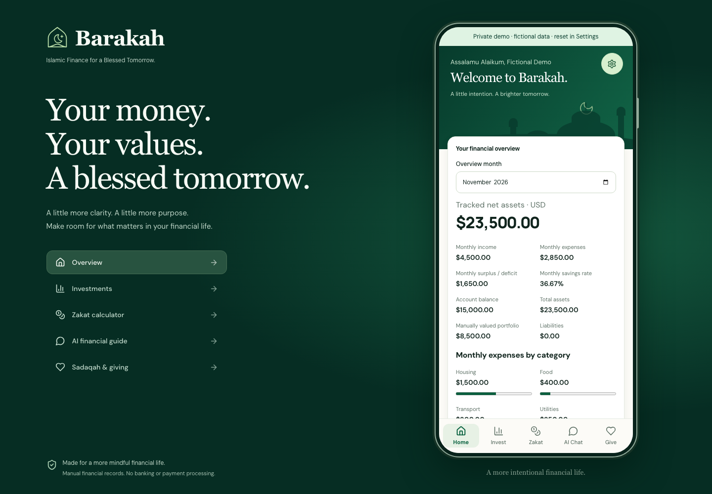
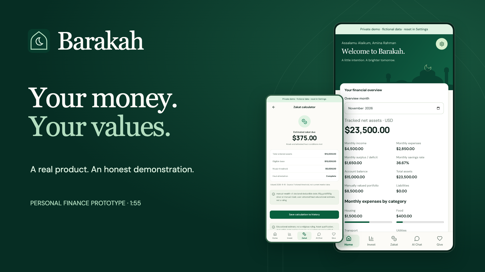
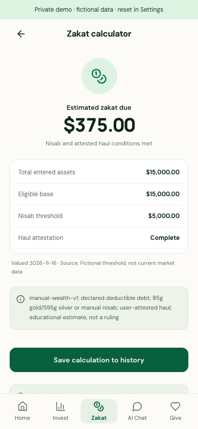
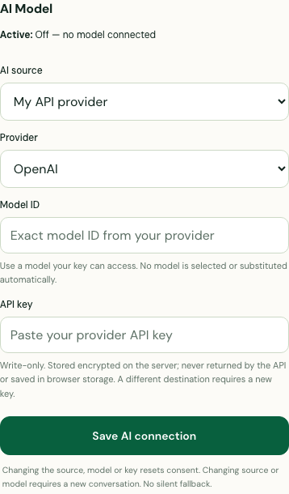
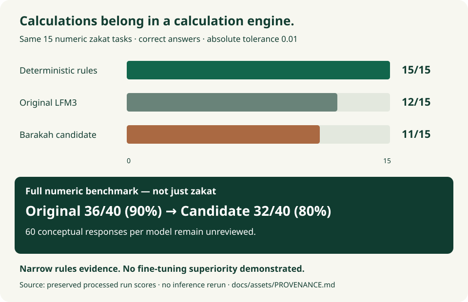

# Barakah

### Your money. Your values. A little more clarity.

Track everyday spending, plan a savings goal, estimate zakat and record giving — in one personal-finance workspace. Barakah keeps **manual financial records**, not your money: no bank sync, payments, brokerage execution or live prices.



*Real local app, fresh Try Demo workspace, entirely fictional data. [Screenshot and chart provenance](docs/assets/PROVENANCE.md).*

**[Try the public demo](https://barakah-gamma.vercel.app)** · **[Watch the demo](https://drive.google.com/file/d/1CirQfcmoW9D3MZjUdrb85dgt8V_h7S4r/view)** · **[Run locally](#run-locally)** · **[AI setup](docs/user-ai.md)** · **[Credits & licenses](docs/CREDITS.md)**

> **Production verified 15 November 2026 (UTC):** personal-account AI settings and secure OpenAI key storage are deployed. AI stays off until a personal user saves a connection and consent; demo accounts cannot save keys. Custom destinations are not enabled on this deployment. **Successful external inference remains unverified.** The private pinned checkpoint is separate; finance tools need no AI service.

**This project is a prototype and is not financial advice. Islamic finance is educational, not religious certification.**

## Watch the 115-second demo

[](https://drive.google.com/file/d/1CirQfcmoW9D3MZjUdrb85dgt8V_h7S4r/view)

Real synthetic-data workflows and genuine private-model failures. This stable video link is versioned with the release package. **No successful external inference is claimed.** [Release files and verification](https://drive.google.com/drive/folders/1qcRacwBeBUfiOjNu5KPX-jCEcr-nmcQI).

## From a monthly picture to a practical plan

1. **See where you stand.** Accounts, transactions and budgets feed the overview. The fictional demo starts with $4,500 income, $2,850 expenses and $1,650 monthly surplus.
2. **Make room for a goal.** Track earmarked savings, such as the demo's $5,000 Hajj goal with $1,250 contributed. Goals do not create extra assets or move funds.
3. **Document zakat assumptions.** Enter eligible assets, deductible liabilities, a dated manual nisab and haul attestation. Save a calculation and record payments made elsewhere.
4. **Keep giving and investments visible.** Record sadaqah, maintain holdings and trades, and enter dated valuations. Educational screening is not halal certification.

<p align="center"></p>

*The demo's $375 estimate uses fictional inputs, not current market prices or a religious ruling.*

Choose **Try Demo** on the login screen. Every browser gets its own editable, non-admin workspace; edits survive reload. **Home → Settings → Reset demo data** resets only that workspace. Demos expire after 24 hours. Never enter real information in a demo. [Full walkthrough](audit/DEMO_GUIDE.md).

## AI is optional, explicit and separate

| Mode | What it means |
|---|---|
| **Off (default)** | No inference or new chat messages. Finance tools continue to work. |
| **My API provider** | Personal accounts only, after secure operator setup. OpenAI or an exact approved HTTPS OpenAI-compatible endpoint; not native Anthropic/Gemini APIs. Your provider, your costs — **not the Barakah checkpoint**. |
| **Private Barakah checkpoint** | A separately configured loopback service pinned to `h8notme/barakah1@912a5697cf9d85adf065ee512f509cfa236459d4`. No external fallback. |

[Personal-account setup and credential boundaries](docs/user-ai.md) · [Private pinned-model setup](docs/local-ai.md).

Save the destination, then save consent before testing or sending. Only your question and bounded recent conversation history are sent; financial records are **never included automatically**. AI cannot change financial records. Changing destination/model requires a new conversation. Keys are masked, write-only and encrypted server-side; encryption is not a promise that an operator cannot access them.

<p align="center"></p>

*Actual local settings, cropped to omit identity. Unsaved selection, empty credentials; not a successful provider connection.*

A private pinned-runtime browser check returned **17 + 8 = 25**, then **21** after subtracting 4; reload restored both pairs with pinned metadata. That demonstrates transport, inference and persistence — **not better financial advice**. Production encrypted storage and real invalid-key rejection were verified using a deliberately invalid synthetic key. No genuine external key or successful external inference was verified.

## What the benchmark actually shows

**Use a calculation engine for calculations, not model confidence.** On the same 15 numeric zakat tasks, the deterministic rules baseline scored **15/15**, original LFM3 **12/15**, and the Barakah candidate **11/15**. This is narrow calculation-engine evidence, **not fine-tuning superiority** or proof of religious correctness.



**Full 40-question numeric result: original 36/40 (90%) vs candidate 32/40 (80%), absolute tolerance 0.01.** The candidate regressed by 10 percentage points. **All 60 conceptual responses per model remain unreviewed.** The finance-superiority objective is unmet; the [FAQ in the official 22-page guide](https://drive.google.com/file/d/15tYD48XRmCgWbk1_lLDtc8lebi6qm-4-/view) sets no minimum accuracy, so these scores do not establish ineligibility.

Known failures remain visible: interest-bearing advice despite restrictions, mishandled support obligations to parents, arithmetic errors, zakat described as interest, and unsupported rulings. Training/test independence, dataset/inherited licensing and expert advice quality remain unresolved. Working inference does not resolve these limits.

**Verified training provenance:** Unsloth run records and export hashes link the submitted checkpoint to **[Azfarhashmi/adaption-personal-finance-advice-dialogues](https://huggingface.co/datasets/Azfarhashmi/adaption-personal-finance-advice-dialogues/tree/3dd7f33149d6cbf4ab9115f76242851506929b9d)**, revision `3dd7f33149d6cbf4ab9115f76242851506929b9d`: 27,981 input records, remastered using **Adaption's Adaptive Data platform** per its card, with **LiquidAI LFM3** as the base. Training stopped at **4413/6996 steps, 1.26 epochs**; two epochs were planned, not completed. The Hub train file includes row-level test/val labels, not a separately withheld evaluation. [Verified chain, credit and remaining limits](docs/TRAINING_PROVENANCE_CORRECTION.md).

- [Matched evaluation and current provenance correction](benchmark/reports/20261115/README.md) · [paired responses](benchmark/results/comparisons/20261115/questions.csv) · [observed live advice failures](docs/local-ai.md#observed-quality-failure).
- **Provenance correction:** [corrected comparison v2](docs/evidence/benchmark-comparison-v2.json) and [correction note](docs/BENCHMARK_PROVENANCE_CORRECTION.md). Historical `comparison.json` copied baseline-template defaults into `candidate_config`; raw rows, run fingerprint and checkpoint manifest identify Barakah. Old artifacts are preserved; this chart reads the processed run scores, not that mislabeled config.
- [Separate exploratory personal-finance evaluation and current provenance](personal_finance/CURRENT_PROVENANCE.md): 50 questions/model, **5/23 → 9/23** on strict numeric fields, substantial formatting failures and unreviewed advice quality. It does **not** replace the matched benchmark or prove superiority.

## Run locally

React/Vite + FastAPI/SQLAlchemy/Alembic. SQLite locally; PostgreSQL supported. Use Python **3.13** and Node **20.19+ / 22.13+ / 24+**.

```sh
python3.13 -m venv backend/.venv
backend/.venv/bin/python -m pip install --require-hashes -r backend/requirements.lock
npm ci --prefix barakah-ui
bash scripts/start-local.sh
# Open http://127.0.0.1:8080 and choose Try Demo
```

The launcher builds the UI, applies additive migrations and serves frontend/API together on loopback. Default database: `backend/barakah.db`. **Back up existing data before upgrading; do not recreate an environment or change databases while its server is running.** [Migration and backup guide](audit/DEMO_GUIDE.md).

Use `PORT=8081 bash scripts/start-local.sh` for another port; `DATABASE_URL` selects a dedicated SQLite file or PostgreSQL database. For Vite development, apply `alembic upgrade head` and run Uvicorn in `backend/`, then `npm run dev --prefix barakah-ui`; set backend `ALLOWED_ORIGINS` to the exact frontend origin. The local launcher is not a production server recipe.

Passwords use Argon2id; access tokens stay in memory and refresh tokens use HttpOnly cookies. Records are owner-checked server-side; accounting uses Decimal. Preferred currency does not convert existing records. Local recovery can use a private `RESET_OUTBOX`; production recovery needs SMTP. [Backend guide](backend/README.md).

## Verify and deploy deliberately

```sh
(cd backend && .venv/bin/python -m pytest -q)
(cd backend && TEST_DATABASE_URL='postgresql+psycopg:///YOUR_TEST_DB' .venv/bin/python -m pytest -q)
npm test --prefix barakah-ui
npm run build --prefix barakah-ui
# Against a running app with an isolated test database:
BARAKAH_UI_URL=http://127.0.0.1:8080 python3 tests/e2e/journey.py
```

`journey.py` uses agent-browser/Chromium and actual backend requests. The AI-settings browser suite labels its UI-only failure fixture separately; no fixture establishes provider inference. Test reports are dated evidence, not automatic verification of another build.

[Vercel setup and verified rollout](docs/VERCEL.md) · [deployment/backups](docs/DEPLOYMENT.md) · [API contract](docs/backend-api.md) · [release audit](docs/RELEASE_AUDIT.md). Historical audit/test reports describe their own snapshots, not automatic verification of today's source or public deployment. Docker/Nginx files are supplied; Docker runtime remains unverified.

## Team Barakah

**Hadi Allahwala · Shameer Mumtaz · Essa Tai**
