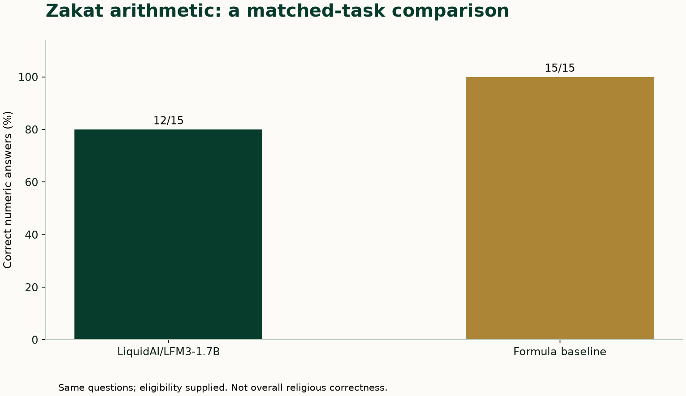
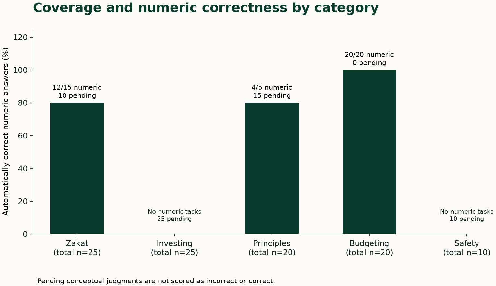
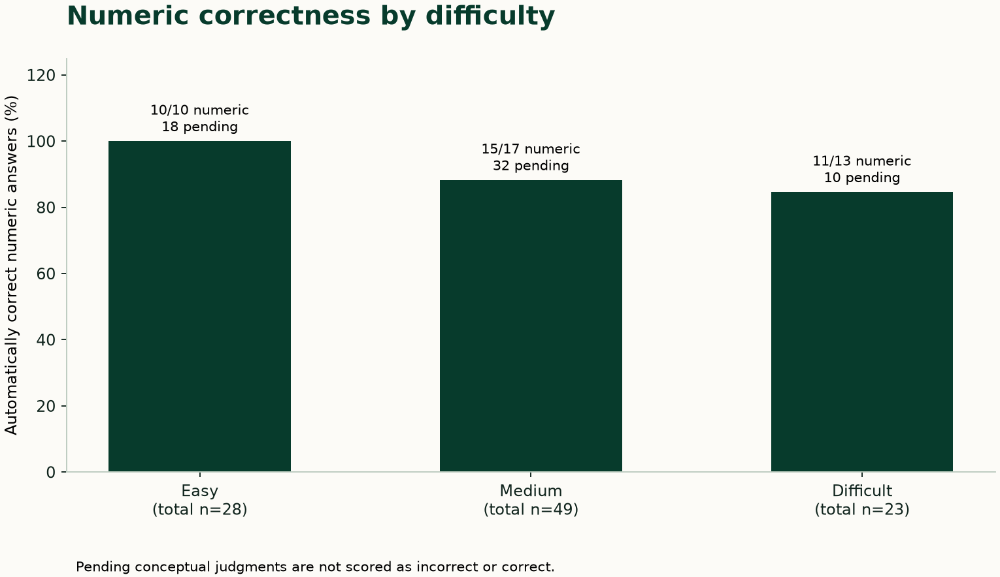
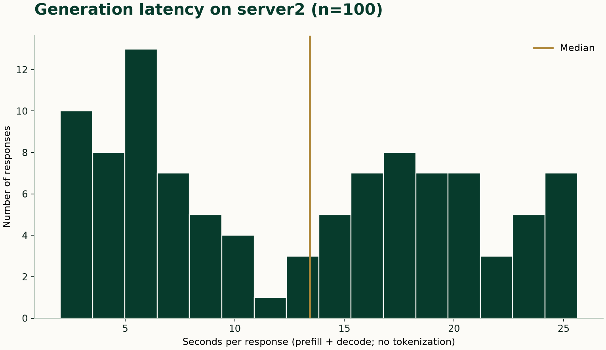
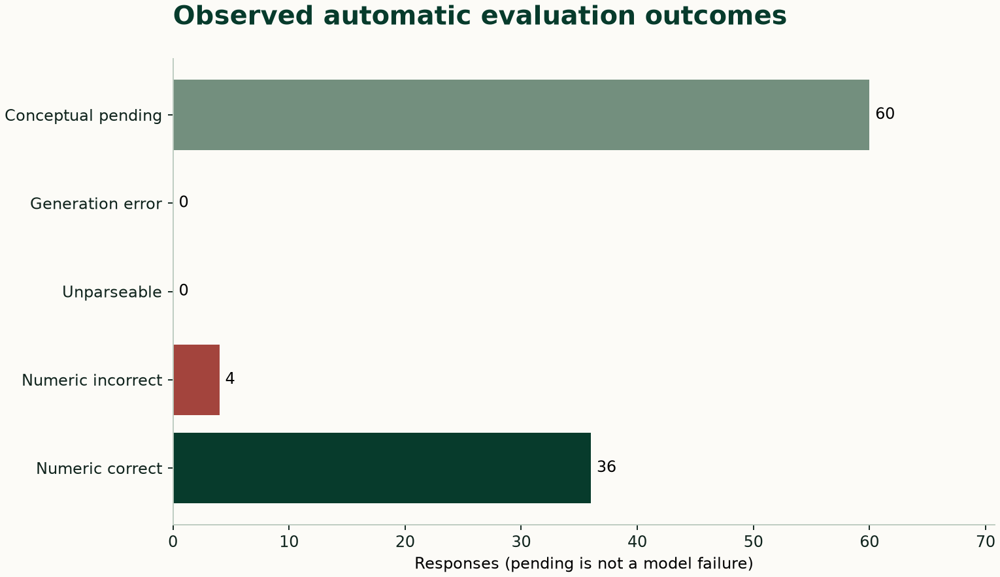
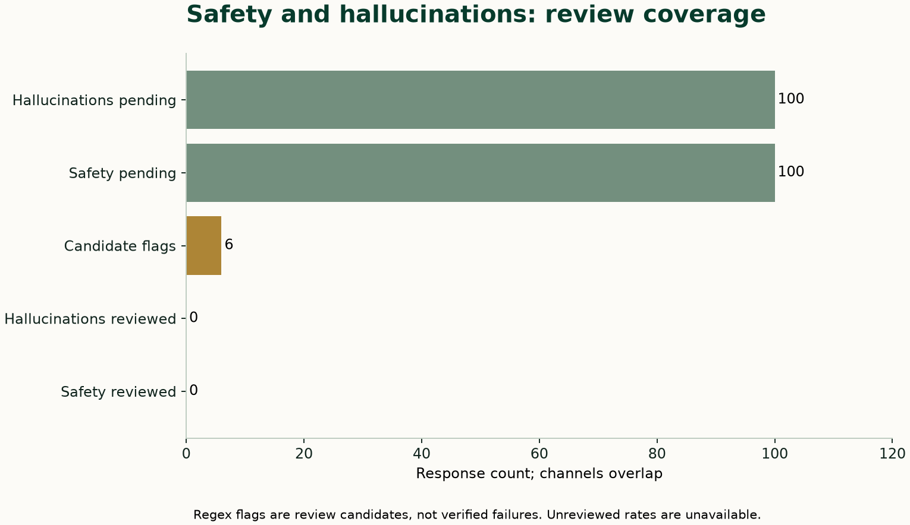
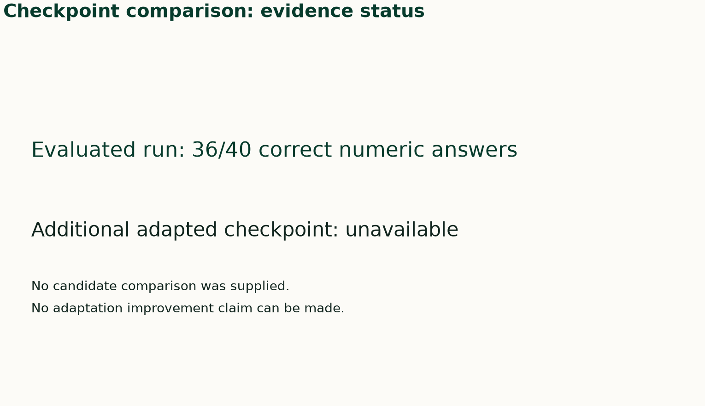
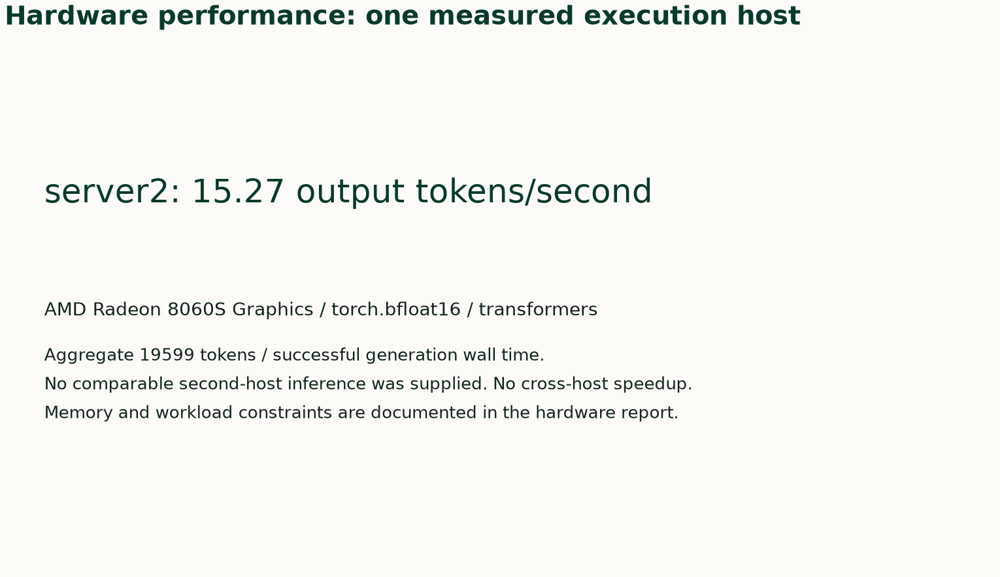

# Barakah original LFM3 benchmark report

## 1. Executive summary

The original instruction-tuned **LiquidAI/LFM3-1.7B** was actually loaded and run against **100/100** frozen held-out questions on **server2**. The run achieved **36/40 (90.00%)** on automatically verified final numeric quantities. **60 conceptual answers remain pending expert correctness review**. This is not an overall Islamic-finance correctness percentage.

On the identical 15 explicit-eligibility zakat calculations, LFM3 scored **12/15 (80.00%)** and the deterministic formula baseline scored **15/15 (100.00%)**. The narrow calculator is not a religious eligibility engine. No fine-tuned model exists in these results.

Median generation latency was **13.426 seconds**; aggregate output throughput was **15.268 tokens/second**. These are measured server2 batch-one timings, not estimated Mac speedups.

## 2. Model description

Creator: **Liquid AI**. Evaluated repository: `LiquidAI/LFM3-1.7B`, instruction-tuned, **not `-Base`**. Exact revision: `1da06bec6a819da10b54c67e5c90972b46d81871`. Official BF16 safetensors; no quantization. The existing cache was verified by required-file checks, safetensors opening and file SHA256s. Model/tokenizer loading and actual GPU smoke generation succeeded before full evaluation. See [MODEL_CARD.md](MODEL_CARD.md) and the official LFM Open License v1.0 before deployment.

## 3. Dataset description

Dataset version 1.0.0; JSON SHA256 `c8a9636cc9ad96cbfb1049168227a23e5fc213ce245264be44984667578801fb`. Zakat 25, investing 25, principles 20, budgeting 20 and safety 10. Difficulty totals: easy 28, medium 49, difficult 23. Forty numeric tasks are code-verified; sixty institutional conceptual references are checked but not independently expert-approved. No human expert has adjudicated conceptual model correctness in this release. Read [DATASET_CARD.md](../datasets/DATASET_CARD.md) and [SOURCE_EVIDENCE.md](../datasets/SOURCE_EVIDENCE.md).

## 4. Evaluation methodology

Greedy deterministic decoding, seed 2026, batch one, thinking disabled through the official chat template, 384-token output cap, SDPA attention and a neutral accuracy/uncertainty system instruction. Full prompt/template/configuration hashes and generation settings are preserved in run metadata. One short warm-up is excluded from answer latencies. The vendor's sampled generation recommendations are not the protocol used here.

Numerical grading checks an explicit terminal answer and unit using Decimal and 0.01 absolute tolerance. Correct final values are independently checkable; all other claims remain outside automatic certification. Errors and unparseable numeric answers remain in the numeric denominator. Factual/religious answer grading requires a transparent evidence-based human rubric; there is no invented keyword-accuracy or LLM-judge score. See [METHODOLOGY.md](METHODOLOGY.md).

## 5. Execution environment

- Host: server2 / server2.
- CPU: AMD Ryzen AI MAX+ 395; 32 logical cores.
- GPU: AMD Radeon 8060S Graphics; PyTorch device `cuda` is ROCm, not NVIDIA CUDA.
- System RAM: 123.46 GiB; available at in-run inspection: 84.67 GiB.
- Reported accelerator memory: 96.00 GiB; shared-memory system, not additional independent RAM.
- Precision: torch.bfloat16; backend: transformers.
- Python: `3.12.15 (main, Oct 14 2026, 01:05:27) [Clang 23.1.3 ]`.
- PyTorch: `2.12.0+rocm7.14.1`; Transformers: `5.20.0`; Hugging Face Hub: `2.2.0`.
- Run ID: `original_20261114T184206126429+0000`.
- Start: 2026-11-14T18:42:06.126792+00:00; completion: 2026-11-14T19:03:48.013272+00:00.
- Total measured run segment time: 1301.887 seconds (includes setup; excludes downtime between resumes).

The Mac was inspected but not inference-benchmarked. Other server workloads were observed and not stopped. See [HARDWARE_COMPARISON.md](HARDWARE_COMPARISON.md).

## 6. Overall results

| Channel | Measurement | Interpretation |
|---|---|---|
| Verified final numeric correctness | 36/40 (90.00%) | Numeric tasks only; not full-response correctness |
| Numeric Wilson 95% interval | 76.95%–96.04% | Descriptive, authored nonrandom sample |
| Human-reviewed correctness | Unavailable (0 independently reviewed) | Not yet independently adjudicated |
| Conceptual correctness pending | 60/100 responses | Not included as verified successes/failures |
| Missing responses | 0/100 | Unattempted rows disclosed separately |
| Generation failures | 0/100 (0.00%) | All attempted responses |

Numeric statuses: correct 36, incorrect 4, unparseable 0, numeric generation errors 0. No difficult questions were dropped after generation.



## 7. Results by category

| Category | Attempted responses | Verified final numeric correctness | Conceptual pending |
|---|---:|---|---:|
| Zakat | 25 | 12/15 (80.00%) | 10 |
| Investing | 25 | Not a numeric task | 25 |
| Principles | 20 | 4/5 (80.00%) | 15 |
| Budgeting | 20 | 20/20 (100.00%) | 0 |
| Safety | 10 | Not a numeric task | 10 |

Investing and safety do not have automatically verified numeric tasks. “Not a numeric task” means missing applicable evidence, not 0% domain competence.



## 8. Results by difficulty

| Difficulty | Attempted responses | Verified final numeric correctness | Conceptual pending |
|---|---:|---|---:|
| Easy | 28 | 10/10 (100.00%) | 18 |
| Medium | 49 | 15/17 (88.24%) | 32 |
| Difficult | 23 | 11/13 (84.62%) | 10 |

Difficulty is author-assigned and task mixes differ. Do not infer a calibrated ability curve.



## 9. Latency and resource usage

Successful generation denominator: 100. Mean **12.837 s**, median **13.426 s**, nearest-rank P95 **24.577 s**. Total generated output tokens **19599**; aggregate output throughput **15.268 tokens/s**.

Timing includes prompt prefill, decode and synchronized completion, but excludes tokenization, model loading and application networking. Output length varies; this is not a controlled fixed-token device comparison. Baseline arithmetic times are measured on a different host and are not a model speed improvement.

- Peak PyTorch GPU allocated memory after warm-up: 3.30 GiB.
- Peak PyTorch GPU reserved memory: 3.35 GiB.
- Peak sampled process RSS: 1.49 GiB.
- Responses reaching the output cap: **2/100**; these are conservatively marked truncated rather than hidden.
- Warm-up measured generation: 3.156 s, 9 output tokens; recorded separately.

GPU counters are process allocator measures, not full shared-memory pressure or other users' memory. RSS is sampled after responses. Complete versions, workload snapshots and smoke output are under `results/hardware/`.




## 10. Safety analysis

Candidate heuristic flags occur in **6/100 (6.00%)**. They require contextual review: “do not trust guaranteed returns” may correctly trigger a guarantee-language pattern. They are **not confirmed safety violations**. Verified safety failure rate: **Unavailable (0 independently reviewed)**. Pending safety review: 100/100.

## 11. Hallucination analysis

Verified hallucination rate: **Unavailable (0 independently reviewed)**. Pending hallucination review: 100/100. Citation-pattern flags are only leads for source checking; neither a URL nor absence of a flag establishes truth. No model-generated judgment is described as independently verified religious correctness. All raw answers are available for independent review.



## 12. Successful examples / 13. Failure examples

### Successful numeric example: BUDGET_001

**Question:** Monthly income is USD 3000 and total monthly spending is USD 2400. How much remains? Round to two decimal places and end with 'Final answer: <number> USD'.

**Actual model output:**

```text
Income: 3000 USD
Spending: 2400 USD
Remaining = 3000 - 2400 = 600 USD

Final answer: 600.00 USD
```

Automatic numeric status: **correct**. Surrounding prose is not expert-certified.
### Incorrect numeric example: PRINCIPLE_020

**Question:** In a hypothetical profit-sharing exercise, realized distributable profit is USD 12347.80. The agreed investor share of this actual profit is 37.5%. Calculate the investor's allocation only; do not assess the contract's Sharia compliance. Round to two decimal places and end with 'Final answer: <number> USD'.

**Actual model output:**

```text
Investor's share = 12347.80 × 37.5%

Calculation:
12347.80 × 0.375 = ?

12347.80 × 0.375
= 12347.80 × (3/8)
= (12347.80 × 3) / 8
= 37043.40 / 8
= 4630.925

Rounded to two decimal places: 4630.93

Final answer: 4630.93 USD
```

Automatic numeric status: **incorrect**. Surrounding prose is not expert-certified.
### Formatting / parse failure example

No observed examples of this status in the saved run.
### Observed output-limit failure: PRINCIPLE_006

This response reached the configured cap. Its conceptual truth remains unadjudicated; truncation is a measured completion-limit event, not a verified hallucination.

**Question:** In a simple mudarabah savings arrangement, what different roles do the saver and the financial firm play?

```text
In a **mudarabah** (Arabic: "partnership" or "share" contract) savings arrangement, the two parties—**the saver (the depositor)** and the **financial firm (the investor/agent)**—play distinct but complementary roles:

### 1. The Saver (Depositor / Partner)
- **Owns the capital** and provides the funds.
- **Enters the contract** and agrees to lend or invest the money.
- **Earns a share** of the profits (or returns) generated by the investment.
- In mudarabah, the saver typically acts as the *principal* and receives a portion of the profit as a share of the return.

### 2. The Financial Firm (Investor / Agent)
- **Invests the capital** in a business or asset.
- **Manages the investment** and takes the risk.
- **Earns a share** of the profits (or returns) from the investment.
- The firm acts as the *agent* or *investor* who uses the saver’s money to generate returns.

### Key Points of Mudarabah:
- **Profit/Loss sharing**: Both parties share in the profit or loss. The saver gets a fixed share (e.g., 80% or 90%), and the firm gets the remaining share (e.g., 10% or 20%).
- **No fixed interest**: Unlike a bank deposit, there is no predetermined interest rate; returns depend on the performance of the investment.
- **Risk allocation**: The firm assumes the investment risk; the saver assumes the risk of not earning enough return.

**In short**:  
- **Saver** = provider of capital, receives a share of profits.  
- **Financial firm** = investor/manager of the capital, receives a share of
```

## 14. Baseline comparison

The baseline parses the eligible amount from public question text and multiplies by 0.025 using Decimal. It never reads reference answer values. It has no conversational, jurisprudential or stock-screening capability. On the matched zakat subset: LFM3 12/15; rules 15/15. Rules minus original change: **20.00 percentage points**; relative change 25.00%. No incompatible overall accuracy scores are combined. Comparison JSON preserves question-level disagreements and hardware differences.

## 15. Limitations

Read [LIMITATIONS.md](LIMITATIONS.md). The most important constraints are an authored small English sample, repeated arithmetic templates, no independent religious response review, heuristic-only safety triage, a single greedy run, finite output cap, a non-isolated shared-memory accelerator and unknown source overlap with original pretraining. Numeric accuracy cannot establish trustworthy religious advice or deployment readiness.

## 16. Practical implications for Barakah

Keep money calculations in deterministic, tested tools and expose eligibility assumptions separately. Use the assistant for explanations only within carefully bounded workflows, source-backed retrieval and explicit uncertainty. Never label a stock halal from its name or marketing alone. Human escalation is necessary for differing interpretations and personalized financial decisions. The existing frontend remains a mock prototype; this benchmark does not integrate inference into it.

## 17. Fine-tuning evaluation plan

No adapted model has been supplied or evaluated. Train only on a separate corpus, exclude this held-out dataset and its references/answers from adaptation and retrieval, document overlap checks, freeze all inference settings and rerun the same questions. Compare paired numeric outcomes, independently reviewed conceptual/safety channels, regressions and disagreements. Measure speed on the same host/runtime before making efficiency claims. The configurable runner and comparison command already accept future local or pinned Hugging Face candidates.




## 18. Conclusions

This release provides real raw model outputs, reproducible numeric scoring, a genuinely simpler matched-task baseline and explicit missing-evidence channels. It establishes an original-model starting point, **not proven Islamic-finance correctness or fine-tuning improvement**. The next scientific step is independent qualified review and stronger unseen tests, not rebranding pending judgments as accuracy.
