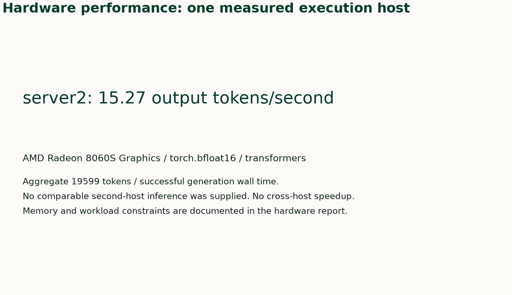

# Hardware inspection and execution decision

## Local Mac (actually inspected)
- OS: macOS-27.0.1-arm64-arm-64bit; hostname MacBook-Air.local.
- CPU: Apple M4; logical/physical cores 10/10.
- RAM total / available: 16.00 GiB / 3.88 GiB.
- Free disk at probe: 3.88 GiB.
- CPU utilization during sample: 23.1%; load averages [5.37353515625, 4.11083984375, 3.419921875].
- Python: `3.12.14 (main, Sep  1 2026, 14:09:38) [Clang 22.1.3 ]`. GPU runtime probe: `{'available': False, 'reason': 'PyTorch not installed'}`.
- Apple M4 integrated GPU/unified memory is part of the Mac hardware, but no functioning local PyTorch inference configuration was claimed by the initial probe.

## Server2 (actually inspected and used)
- OS: Linux-6.19.10-300.fc44.x86_64-x86_64-with-glibc2.43; hostname server2.
- CPU: AMD Ryzen AI MAX+ 395; logical/physical cores 32/16.
- RAM total / available: 123.46 GiB / 96.32 GiB.
- GPU: AMD Radeon 8060S Graphics; total/free reported accelerator memory 96.00 GiB / 76.67 GiB.
- ROCm/HIP: 7.14.60850; NVIDIA CUDA: None. ROCm is exposed through torch.cuda.
- Free disk: 344.74 GiB; CPU utilization 9.5%; load averages [2.7939453125, 2.8115234375, 2.818359375].
- PyTorch `2.12.0+rocm7.14.1`; Transformers `5.20.0`.
- Exact official checkpoint already cached. No second model copy or quantization was needed.

## Decision before download/inference

**Selected server2.** It had substantially more free RAM/disk and the exact existing BF16 checkpoint, plus a verified compatible AMD GPU runtime. The Mac's roughly four GiB free disk offered little margin for a roughly 3.3 GiB checkpoint and Python/runtime overhead. Server2 avoided both a redundant model download and a local backend setup. These are measured resource/compatibility advantages, **not a claimed measured inference speedup**.

Network model-download speeds were not compared: the exact snapshot was already present and hash-verified. SSH and script/result transfer succeeded; small result transfer is far cheaper than another checkpoint transfer. No bandwidth benchmark or invented throughput estimate is included.

## Actual compatibility and performance evidence

Cold first smoke: model load 5.856 seconds; 42 generated tokens in 4.994 seconds (8.410 tokens/second), including possible compilation. It answered the arithmetic prompt. This short cold test is **not** a steady-state hardware benchmark.

Full original-model run: 100 attempted responses, mean 12.837 s, median 13.426 s, P95 24.577 s, aggregate 15.268 output tokens/s. Peak PyTorch allocated/reserved GPU memory: 3.30 GiB / 3.35 GiB. Peak sampled RSS: 1.49 GiB.

## Workload safety and comparison limits

Other memory/CPU workloads were observed in process snapshots, including existing Python/ComfyUI activity. None was stopped, reconfigured or overwritten. No root/system package, SSH, firewall or inference-routing configuration was changed. The existing compatible Python environment was used read-only in a new user-owned benchmark work directory.

The logged rocSHMEM libnuma warning and unreadable unrelated Hugging Face tree-cache warning did not prevent verified model loading/inference. No shared cache permissions were changed to suppress them. Logs preserve them.

Only server2 was inference-tested. Local Mac vs server2 inference throughput is **unavailable**; there is no direct two-host chart or speedup ratio. The simple formula baseline ran locally, but this is a different workload and cannot establish an LLM hardware speed comparison. The GPU uses shared system memory; do not add its reported memory to host RAM as separate capacity.

Snapshots: `../results/hardware/local.json`, `server2.json`, run metadata, `smoke.json`, `model_download.json`; sysfs GPU counters and active workloads are recorded where accessible. Resource values vary over time. The Mac workspace experienced iCloud dataless-file errors; selected files were explicitly materialized and the local analysis interpreter was outside the synced directory. No unrelated files were deleted to create space.

