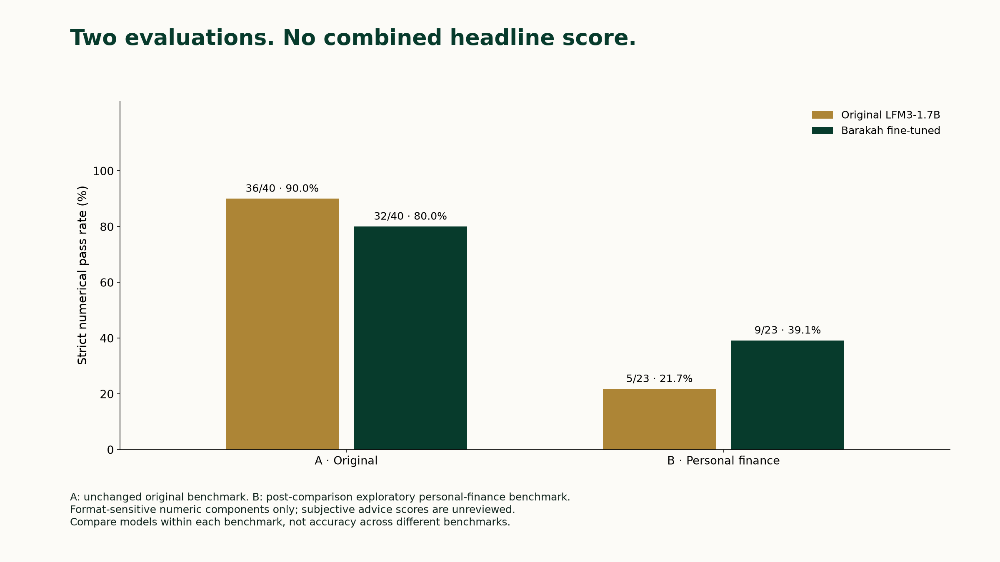
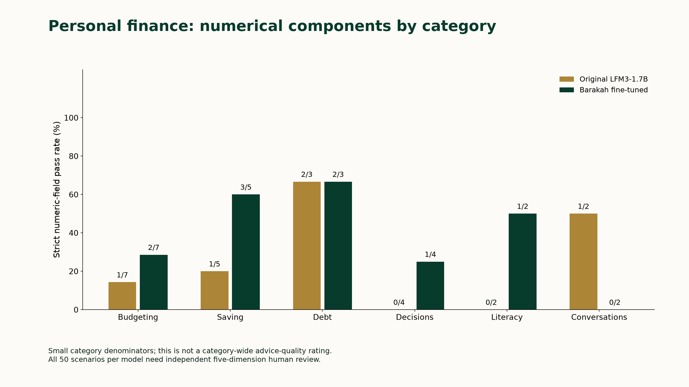
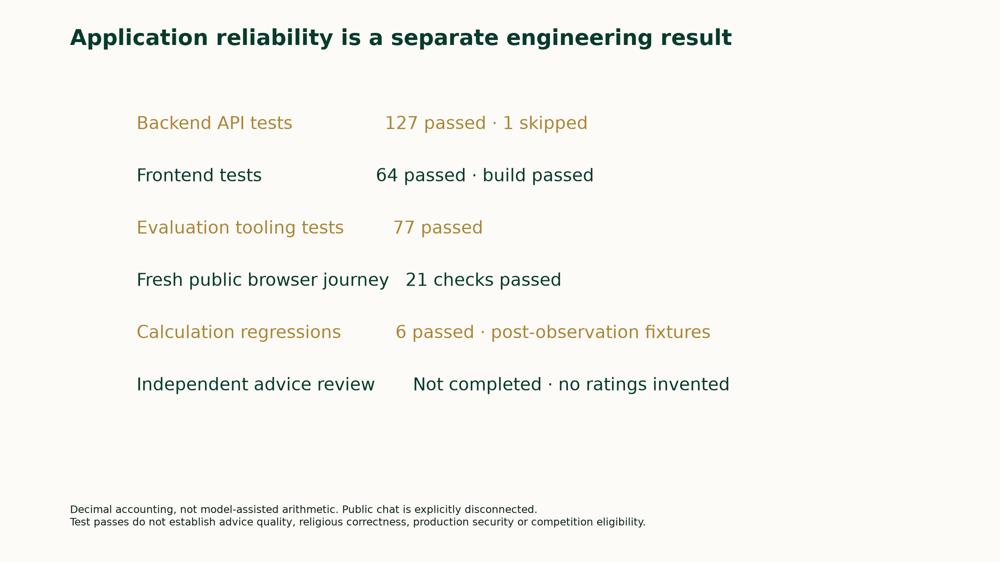

# Barakah — Fine-Tuning Evaluation and Personal Finance Domain Adaptation

> **Provenance correction — 16 November 2026:** the actual training dataset, selected Hub split, base revision and stopped checkpoint/export chain are now verified. Earlier uncertainty below describes the historical investigation, not current knowledge. Read the [verified provenance and credits](../../docs/TRAINING_PROVENANCE_CORRECTION.md). Dataset/inherited licensing, held-out independence and expert advice quality remain unresolved; scores and raw evidence are unchanged.

**Evaluation date: 2026-11-15 UTC. This project is a prototype and is not financial advice.**

## Executive summary

Barakah is an Islamic personal-finance tracker and a study of domain adaptation for a small conversational model. The evaluation deliberately separates **model-only calculation accuracy**, **unreviewed advice quality**, and **deterministic application accounting**.

The original comparison does **not** demonstrate an improvement: LiquidAI/LFM3-1.7B scores **36/40 (90%)**, while h8notme/barakah1 scores **32/40 (80%)** on numerical questions. Both answered all 100 original questions. All 60 conceptual answers per model still need qualified review. No question, reference, raw answer, historical score or benchmark weighting was changed to favor the adapted model.

The separate **Personal Finance Domain Adaptation Benchmark v1.0** completed all **50 scenarios per model**. Barakah passed **9/23 (39.1%)** strict numerical-field checks versus **5/23 (21.7%)** for LFM3. This is a higher **format-sensitive pass rate**, not established improvement in practical advice: formatting failures and truncation are substantial, and all human quality scores remain null. The measured trade-off is worse original arithmetic performance but better adherence/correctness on the new strict numerical-field metric; dialogue usefulness remains unresolved.



The functioning web product uses deterministic Decimal calculations. **Its deployed chat is explicitly disconnected**; offline benchmark inference is not live application integration. A later opt-in private local integration has separate real browser/inference evidence in [the release audit](../../docs/RELEASE_AUDIT.md); it does not change these neutral-prompt scores. Public chat remains disconnected. The finance challenge's requested advantage over a simple rule is not established, and eligibility still needs truthful owner/organizer confirmation.

## Why this model and training objective?

LFM3-1.7B is a practical small-model choice for local experimentation: the inspected checkpoint has **1,728,801,536 parameters**, approximately 3.46 GB of BF16 weight data, and actually runs on server2's AMD Radeon 8060S with ROCm. This is an engineering rationale, not evidence that it outperforms other architectures. No comparative model-selection study was performed.

The team reports that Barakah was trained primarily on **personal-finance advice dialogues**, not exclusively Islamic finance. The public checkpoint card names LFM3-1.7B as its base and credits Unsloth/TRL, but does not publish a checkpoint-linked training manifest, exact training-base revision, split membership, hyperparameters or training logs. The public corpus `Azfarhashmi/adaption-personal-finance-advice-dialogues` was named in the team's earlier household-finance work and is a candidate overlap-screening corpus; that alone does not prove precisely which rows trained this checkpoint.

Consequently, this report distinguishes team-reported training intent from independently inspected model artifacts. **No model was retrained and no weights were modified during this mission.**

## Evaluation A — unchanged original benchmark

### What it measures

The frozen v1.0.0 benchmark contains 100 English questions: **zakat 25, investing 25, Islamic-finance principles 20, budgeting 20, safety 10**. Forty ask explicit numerical questions; sixty require substantive human review. It measures a broader Islamic-finance/product scope than a general personal-finance dialogue training objective. A result on its 40 calculations is not an overall score for religious knowledge, conversational quality, investment safety or financial advice.

Dataset SHA256: `c8a9636cc9ad96cbfb1049168227a23e5fc213ce245264be44984667578801fb`.

### Checkpoint loading and fair comparison

| | Foundation model | Barakah |
|---|---|---|
| Repository | `LiquidAI/LFM3-1.7B` | `h8notme/barakah1` |
| Revision | `1da06bec6a819da10b54c67e5c90972b46d81871` | `912a5697cf9d85adf065ee512f509cfa236459d4` |
| Artifact | Full BF16 checkpoint | Full BF16 checkpoint, not a PEFT adapter |
| Run | `original-matched_20261115T153923318073+0000` | `barakah-matched_20261115T154845353654+0000` |

The candidate is not an unchanged base accidentally loaded without an adapter: saved tensor inspection found **116 of 286 tensors changed**. The loader verifies snapshot inventories and fails closed on adapter artifacts instead of pretending to support PEFT. A merged full checkpoint does not establish whether the original training method was LoRA.

Both runs used server2, BF16, SDPA, the same software versions, neutral system prompt, greedy generation, seed 2026, thinking disabled, 384 new tokens, repetition penalty 1.0 and eight CPU threads. All 100 rendered prompts and input-token sequences match. Tokenizer files differ in serialization but their evaluated inputs match. The sole differing saved checkpoint generation default is `max_length`; the identical explicit `max_new_tokens=384` overrides it. Metadata's `effective_generation_config` field stores pre-override defaults, so use it together with the recorded call configuration—not alone.

No calculator, retrieval, external judge, or application context was supplied to either model. Runs were sequential on a shared host; latency is descriptive, not an isolated speed experiment. [Full provenance](../reports/20261115/MODEL_PROVENANCE.md) and [methodology](../reports/20261115/METHODOLOGY.md).

### Results and grading audit

| Original benchmark metric | LFM3 | Barakah |
|---|---:|---:|
| Strict-format numerical accuracy | **36/40 (90%)** | **32/40 (80%)** |
| Parsed but incorrect final quantity | 4/40 | 8/40 |
| Unparseable numerical output | 0/40 | 0/40 |
| Generation failures | 0/100 | 0/100 |
| At token limit | 2/100 | 13/100 |
| Conceptual answers with completed correctness review | **0/60** | **0/60** |
| Verified safety/hallucination review denominator | **0** | **0** |

The original strict grader checks the terminal `Final answer:` quantity and unit with absolute tolerance 0.01. It already accepts common bold formatting, commas and `$`. It has known limitations for prose unit names or commentary following the final answer, but **none of this pair's numerical answers is unparseable**. Incorrect quantities really differ from the reference. A fresh engineering audit independently recomputed all 40 references with rational arithmetic and reproduced both published strict scores.

**No separate semantic-numeric correction was applied, because this audit found no formatting penalty to correct.** Audit agreement is not an extra score or professional review of the surrounding advice. [Machine-readable audit](evidence/original_numeric_audit.json); [audit script](../scripts/audit_original.py).

| Category | LFM3 numeric | Barakah numeric | Conceptual pending per model |
|---|---:|---:|---:|
| Budgeting | 20/20 | 17/20 | 0 |
| Zakat | 12/15 | 11/15 | 10 |
| Islamic-finance principles | 4/5 | 4/5 | 15 |
| Investing | Not numerically scored | Not numerically scored | 25 |
| Safety | Not numerically scored | Not numerically scored | 10 |

The paired change is **−10 percentage points**, with zero improvements, four regressions, 32 shared successes and four shared failures. Regressions: `BUDGET_006`, `BUDGET_013`, `BUDGET_016`, `ZAKAT_014`. Exact two-sided McNemar p=0.125; the small, nonrandom authored sample does not support broad significance/generalization claims. More truncation is observed in Barakah, but its cause and effect on unreviewed advice quality remain uncertain.

The historical November 14 original result remains 36/40. The separate historical simple-rule baseline is **15/15 zakat calculations**, versus the foundation model's 12/15 on those same questions; it is **not another language model, not a 100-question score, and not proof of a trained-model advantage**.

[Original comparison charts and paired answers](../visuals/20261115/html/index.html) · [full matched report](../reports/20261115/BENCHMARK_REPORT.md).

## Evaluation B — Personal Finance Domain Adaptation Benchmark v1.0

**Completed: 50/50 scenarios per model, no missing responses or generation errors.** The full sample was selected before inference; the predefined 12-item emergency subset was not used. [Dataset, frozen protocol and raw outputs](../../personal_finance/README.md) · [detailed results](../../personal_finance/REPORT.md).

| Personal-finance metric | LFM3 | Barakah |
|---|---:|---:|
| Strict labeled numerical-field passes | **5/23 (21.7%)** | **9/23 (39.1%)** |
| Parsed but incorrect final fields | 0/23 | 3/23 |
| Unparseable final fields | 18/23 | 11/23 |
| Responses at 384-token limit | 27/50 | 17/50 |
| Generation errors | 0/50 | 0/50 |
| Completed human advice reviews | **0/50** | **0/50** |

This observed pass-rate difference is **+17.4 percentage points**. Three numerical probes passed for both models, six only for Barakah, two only for LFM3, and twelve for neither. All 23 remain in the denominator. **Unparseable does not mean the narrative arithmetic is wrong; a passing field does not certify the narrative.** There was no post-outcome relaxation, selective rerun, question exclusion or alternate semantic score. The other 27 scenarios have no automated correctness score; all 50 need complete-answer review.

| Category | LFM3 strict numeric | Barakah strict numeric |
|---|---:|---:|
| Budgeting/cash flow | 1/7 | 2/7 |
| Saving/emergency funds | 1/5 | 3/5 |
| Debt management | 2/3 | 2/3 |
| Financial decisions | 0/4 | 1/4 |
| Literacy/planning | 0/2 | 1/2 |
| Personalized conversations | 1/2 | 0/2 |

These small denominators describe numerical-field performance only, not category-wide advice strengths. The conversational numerical subset regressed even though the overall strict-field count increased. Conversation scenarios encode prior statements and updates in one prompt; they are not live multi-turn memory tests.



### Freeze, construction and inference integrity

Questions SHA256: `4160cb05aa36e2c2f968634251befc9b527746e644ff6a118845db6dd32ff558`. Freeze-manifest SHA256: `9b1536cfdae0fadbb1bb68ba4d78f97f9a26d204e28a3c0e8370ca312955ddbb`. Question/rule/config freeze: **16:18:54 UTC**; first inference: **16:19:04 UTC**. The AI author wrote scenarios before inspecting new outputs. Hashes provide integrity, not an externally trusted timestamp.

Read-only screening checked all **27,981 rows** of the available public candidate corpus at revision `3dd7f33149d6cbf4ab9115f76242851506929b9d`: zero number-masked exact matches, zero trigram-containment flags at 0.55, maximum 0.2444. Top-ranked excerpts received author review for obvious scenario reuse. This is a limited lexical/AI-author screen, not independent semantic validation; the actual training manifest is unavailable.

Both models used the same neutral system prompt and pinned checkpoints as Evaluation A, with matched BF16/SDPA, seed, greedy decoding and 384-token cap. All 50 rendered prompts and full input-token sequences match. A supplemental audit of installed Transformers' generation-default merging confirmed the operative generation settings match for every prompt. Both used Python 3.12.15, PyTorch 2.12.0+rocm7.14.1 and Transformers 5.20.0 on server2. Raw failures, tokens, timings and truncation flags are preserved; no calculator/reference was injected. See [16-check integrity receipt](../../personal_finance/results/final_validation.json).

Its question is: *Did fine-tuning improve practical, accurate, contextual personal-finance guidance?* It is an **additional exploratory evaluation created after seeing the initial aggregate comparison**, not an independent confirmation or a replacement for Evaluation A. Questions were authored without examining new model responses, screened against available candidate training text, and frozen with the original rubric/config hashes before inference; the later subjective-rubric deviation is disclosed below. Unavailable training lineage limits any clean held-out claim.

The frozen 50-question distribution is budgeting/cash flow 10, saving/emergency funds 8, debt management 8, financial decisions 8, literacy/planning 8, personalized conversations 8. Conventional-interest examples assess hypothetical arithmetic and general financial literacy, not Sharia permissibility. Cases address income variability, family obligations, limited savings, competing goals, emergencies, missing information and risky assumptions. Numerical component scoring cannot certify an answer's complete advice quality.

The initially frozen rubric accidentally substituted communication/empathy for a separate reasoning/trade-offs dimension. Inference launched at 16:19:04 UTC after the 16:18:54 freeze. A prospective worker correction at 16:22:26 was superseded by the parent's canonical five-dimension amendment at 16:25:04 (adopted at 16:27:14). Both authors recorded no inspection of new answer text or numerical outcomes before these corrections. **This is a disclosed late subjective-rubric deviation, not a fully pre-inference five-dimension rubric.** The original files remain frozen; questions, numerical rules, inference and numerical scores are unchanged. No subjective ratings exist.

Only the [canonical prospective rubric](personal_finance_rubric_amendment.json) should be used for future human review: financial correctness, practical usefulness, personalization, reasoning/trade-offs, safety/uncertainty, each 0–4 with examples. No LLM judge or fabricated human ratings are ground truth. There is **no combined A+B headline score**.

## Application-level reliability — separate from both model benchmarks

The product's financial totals are not generated by an LLM:

- `backend/app/finance.py`: owner-scoped transaction ledger, category expense totals, budget usage/remaining amounts, per-currency dashboard cash flow and savings rate. Zero income produces no invented savings percentage; currencies are not silently combined.
- `backend/app/calculations.py`: Decimal zakat estimate, explicit user-attested haul, selected manual/gold/silver nisab, declared deductible liabilities and rate; estimate is educational, **not a religious ruling**. Trade accounting also uses Decimal.
- `backend/app/common.py`: explicit round-half-up monetary rounding. The original benchmark's reference rounding remains unchanged; the two systems are not quietly interchanged.
- `backend/app/schemas.py`: finite, bounded money values and supported currencies at the API boundary.
- `backend/app/ai.py`: disconnected AI returns an explicit unavailable result. It does not invent a market price, recommendation, religious ruling or saved assistant message.

No speculative new calculator endpoint or live model integration was added under the deadline. Existing deterministic implementation was retained, and **six additional API regression tests** now cover the four observed model-calculation failure scenarios, exact-cent arithmetic and zero-income behavior. These are **post-observation debugging fixtures**, intentionally not a newly held-out model comparison. All six passed; the model weights and model-only scores were unaffected.

A fresh public Chromium journey completed **21/21 checks**: real demo data, Secure/HttpOnly refresh cookie, transaction creation/correction, reload persistence, cross-demo isolation, reset isolation, zakat, honest unavailable AI, mobile overflow, registration/login and cleanup of its temporary registered user. Two earlier test attempts exposed missing readiness waits in the test script; their logs were retained and the waits corrected before the successful run. [Verified receipt](evidence/public_demo_verified.log).

Final local execution: **127 backend tests passed, one PostgreSQL-specific test skipped; 64 frontend tests passed; frontend production build passed; 77 evaluation-tooling tests passed; 9 personal-finance protocol/review-packet tests passed**. The six calculation regressions are included in the backend total, not extra independent samples. These are engineering test counts, not model accuracy or a guarantee of production safety. [Backend receipt](evidence/backend_tests.log) · [evaluation receipt](evidence/benchmark_tests.log) · [personal-finance receipt](../../personal_finance/results/final_tests_local.txt).



Remaining app limits include manually supplied valuations, no debt amortization calculator, no bank/payment/brokerage integration, no live market data or certification, and no connected AI. Financial write retries are not generally idempotent; do not introduce automatic retries without transactional safeguards. Manually dated valuations are not verified-current market prices.

## Reproduce and inspect

Use the pinned dependencies and machine instructions in [benchmark README](../README.md). No model download is needed for rescoring saved outputs.

```sh
python -m pytest benchmark/tests -q
python3 -m unittest discover -s personal_finance/tests -v
python3 -m unittest discover -s personal_finance/amendments -p 'test_*.py' -v
python benchmark/scripts/audit_original.py \
  --baseline original-matched_20261115T153923318073+0000 \
  --candidate barakah-matched_20261115T154845353654+0000 \
  --output /tmp/barakah-original-audit-new.json
(cd backend && .venv/bin/python -m pytest -q)
npm test --prefix barakah-ui
npm run build --prefix barakah-ui
```

The audit refuses to overwrite an existing destination. Raw outputs, original dataset files and historical results are preserved. The personal-finance worker's pre-import report is preserved verbatim; [delivery notes](../../personal_finance/DELIVERY.md) clarify its scope and final repository location. [Pre-mission evidence hashes](evidence/preservation_sha256.json) allow byte-for-byte checking of the 89 evidence files present at mission start. No credentials or model weights belong in the submission repository.

## Submission and limits

Use the explicit `audit/full-application-fix` branch, not the stale default branch. [Submission checklist, portal, deadline and credits](SUBMISSION_CHECKLIST.md). A push publishes code/evidence; it is **not a hackathon submission receipt**. Team eligibility, all-member contributions, complete tool credits, training provenance and core-AI compliance need truthful owner confirmation.

All implementation/code/protocol reviewers in this mission were AI agents; their checks are not qualified human finance or religious review. The narrow personal-finance strict-field improvement is observed, but it does not establish better advice, reasoning or safety. The original numerical score regressed. We do not claim broad model improvement, Islamic scholarly competence, validated advice quality, or clean training-set independence. The useful engineering lesson is that **domain adaptation and exact arithmetic are different capabilities**: preserve the comparison, evaluate the intended dialogue domain separately, and keep reliable money calculations outside the language model.
