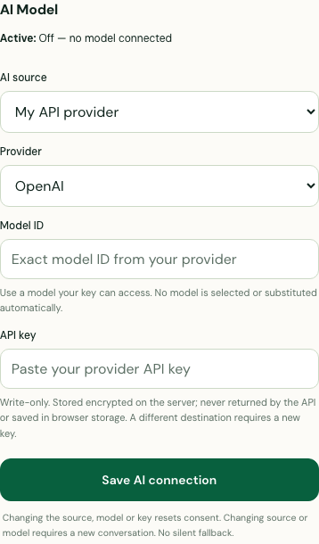

# Connect your own AI provider

**Pending deployment:** this guide describes the new local source, not the older public alias. AI is unavailable by default. Public **Try Demo accounts cannot save keys**; use a personal account on an operator-enabled installation. The finance tools work without AI.

This project is a prototype and is not financial advice. Islamic finance is educational, not religious certification.

## Before you start

- Your operator must enable user-provider AI and configure the dedicated credential-encryption key (below).
- Supported destinations are **OpenAI** (`https://api.openai.com/v1`) or an **exact operator-approved HTTPS OpenAI-compatible base URL**. Custom providers must implement Chat Completions. Native Anthropic and Gemini APIs are not supported.
- Obtain your own provider key and an exact model ID your key can access. Check provider billing, retention and spending limits. No model is automatically selected or substituted.
- This connects **your provider**, not the separately [pinned Barakah checkpoint](local-ai.md). The requested model ID and provider-reported identity are not independently verified execution proof.

## Save, consent, then test

1. Sign in to a **personal account**. Open **Home → Settings → AI Model**.
2. Choose **My API provider**, then OpenAI (or an approved custom provider). Enter the exact model ID and key; for custom providers, enter the approved base URL.
3. Select **Save AI connection**. The key is write-only: masked during entry, cleared from the form after submission, encrypted on the server and never returned by the API or stored in browser storage. A blank key field can keep the saved key for the same destination; a different provider/destination requires a new key.
4. Review the saved destination. Check the consent box and select **Save AI consent**. Changing source, model or key resets consent and test status. Save connection changes before consent.
5. Optionally select **Test saved connection**. This sends a fixed synthetic question, not your history; **it is a real provider request and may cost money**. A valid reply proves neither advice quality nor safety. A saved connection is not itself a successful test.
6. Open **AI Chat**, start a new conversation and send a non-sensitive question. Changing source, destination or model requires a new conversation; old conversations remain available to review or delete.

*Real local UI, synthetic-only personal account; cropped to omit account identity. Unsaved selection, empty key/model fields, active mode still Off. No key was supplied and no provider was called. [Provenance](assets/PROVENANCE.md).*

## What leaves the app — and what does not

After saved consent, the backend sends your question and bounded recent history from the selected, owned conversation. **Financial records are not loaded or sent automatically.** Anything you type may itself be sensitive. Do not send private financial data, credentials or secrets. Providers may retain text and bill your account under their own policies.

Limits are 1,000 characters per question, at most 12 history entries / 12,000 history characters, and 384 requested output tokens. Older turns may be omitted. Defaults are **6 admitted attempts per minute and 30 per day per account**, **one in-flight request per account**, and **8 globally** across the database-backed admission gate. Operators can configure these limits; **tests and failed provider attempts count**, with no refund for ambiguous failures. Provider spending/rate limits apply separately. External requests default to a 35-second total timeout (configurable up to 40 seconds).

There is **no silent fallback**, automatic retry, model substitution or AI-driven financial write. Only validated successful user/assistant pairs persist atomically, with response metadata; failures do not save a new pair. If the browser disconnects after sending, reload history before retrying: the server may already have committed. An expired sign-in requires explicit retry, not automatic replay.

Uncheck consent and save to stop future sends; this also prevents in-flight results from being saved after consent changes, but cannot recall text already transmitted. Answers are plain text, not financial actions, and may be wrong or contradict Islamic-finance restrictions. Verify calculations and seek qualified guidance.

## Remove or replace a key

Use **Remove connection and saved key → Confirm remove connection**. This turns AI off and removes the live database credential, but leaves conversations available to review/delete. It does **not** erase backups or provider-held data. Revoke the key at the provider to invalidate it there. Choosing Off also clears the saved credential when saved.

Encryption at rest is not end-to-end encryption: the backend decrypts keys to make requests. An operator with both the database and encryption key can access credentials. Protect and separately manage database backups and secrets; do not log request headers, keys or chat text in proxies/observability systems.

## Operator setup

Apply migrations through the normal release process before enabling this feature; use persistent storage, trusted HTTPS origins, secure cookies and normal authentication. See [Vercel](VERCEL.md) for deployment setup. Configure only **server-side** variables, never `VITE_` variables:

| Variable | Required configuration |
|---|---|
| `USER_AI_ENABLED` | `true` to permit personal-account provider connections; default is `false` |
| `AI_CREDENTIAL_KEY` | Dedicated base64-encoded **32-byte random key**, supplied privately through your secret manager; separate from `SECRET_KEY` and `AI_TOKEN` |
| `AI_ALLOWED_BASE_URLS` | Optional comma-separated exact approved HTTPS base URLs; empty means no custom destinations |
| `AI_REQUESTS_PER_MINUTE` / `AI_REQUESTS_PER_DAY` | Defaults `6` / `30` |
| `AI_GLOBAL_INFLIGHT_LIMIT` | Default `8` |
| `EXTERNAL_AI_TIMEOUT_SECONDS` | Default `35`, maximum `40` |

No secret value is provided here. Missing or invalid encryption setup keeps user-provider AI unavailable. Keys use AES-256-GCM with owner/provider/destination/revision binding. **Rotation requires a planned migration or users replacing their keys**; simply changing the encryption key makes existing ciphertext unreadable. Keep the old key only under a controlled migration/retention plan, not in public docs or Git.

Custom destinations must match the allowlist, use HTTPS port 443 and a public DNS hostname, and have no URL credentials, query or fragment. The transport rejects private/reserved IP destinations, validates resolved addresses, retains TLS hostname verification, and follows no redirects or environment proxies. This is constrained OpenAI-compatible egress, not arbitrary endpoint support. Review each approved operator destination and its data policy.

`AI_MODE=unavailable` disables the private local model but is **not a global external-provider kill switch**. Keep `USER_AI_ENABLED=false` as well to leave BYOK unavailable. Existing saved external connections fail closed when the operator disables user-provider AI; there is no fallback. Private pinned-model setup is independent and uses [its own loopback service](local-ai.md).

## Verification boundary

This presentation exercised real local registration and settings UI without a genuine API key, test call or external inference. Transport/security implementation tests do not prove provider compatibility or advice quality. Before a public rollout, independently verify the integrated migrations, encrypted storage, consent, removal, quotas and failure paths; any live provider verification must be separately authorized and budgeted. Do not treat the older public deployment as verification of this feature.
